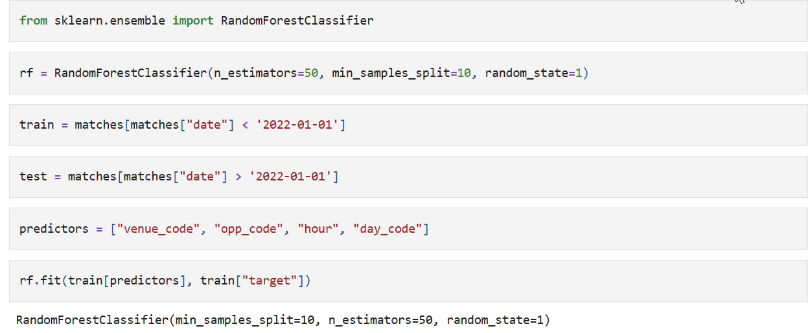
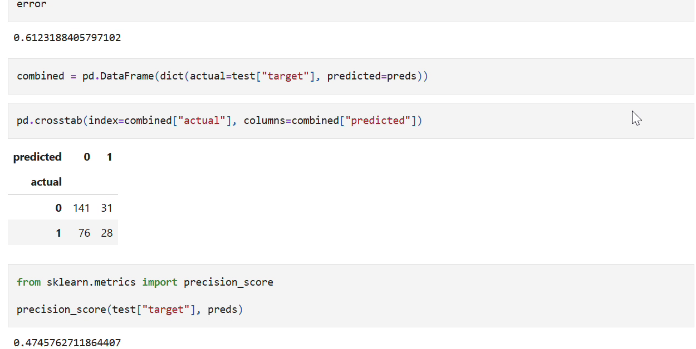
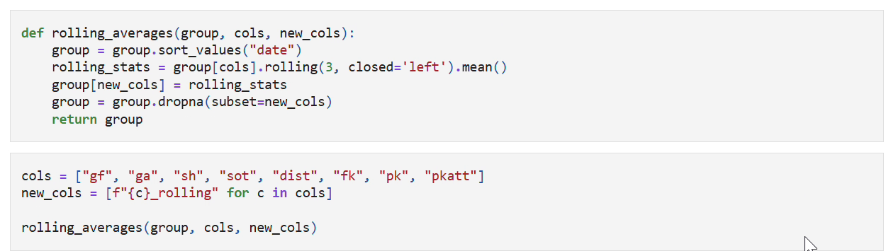
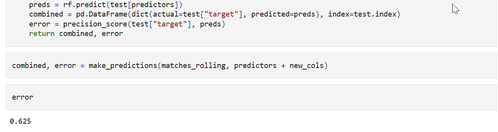

# Premier League Match-Outcome Prediction

Machine-learning experiments for football forecasting, with a React interface under development.

The project explores how historical match data and recent team form can support Premier League predictions. The research goal is to estimate home-win, draw, and away-win probabilities and assess how reliable those probabilities are—not just whether the predicted winner is correct.

## Current development

The archived experimental pipeline predicts a team's win versus non-win. A separate, newly rebuilt Flask service now serves fixture-level home-win, draw, and away-win estimates to React. Its fixed-setting Gradient Boosting model uses pre-match form from both clubs. It is uncalibrated and does not reproduce the earlier reported 75% result.

| Component | Status |
|---|---|
| Frozen historical CSV and original scraping notebook | Included, with provenance and coverage audit |
| Binary Random Forest baseline and lagged form experiment | Reconstructed from recorded notebook evidence; reproducible |
| Rolling feature checks and chronological split details | Reproducibility verification included |
| Logistic Regression / Random Forest / Gradient Boosting | Reported comparison plus a separately labeled supplemental experiment |
| React interface | Calls Flask and displays all three model estimates |
| Three-class fixture models | Bundled historical baseline plus refreshable, date-aware Gradient Boosting; active holdout metrics are exposed at `/api/status` |
| Calibration, independent final evaluation, interpretability | Not yet completed |

## Experimental results

The archived recording shows a 1,107-row training set and 276-row test set, using a strict January 1, 2022 boundary. Six boundary-day rows are excluded. Its Random Forest baseline reports **61.23% accuracy** and **47.46% win precision**. The always-non-win baseline achieves **62.32% accuracy**, so the metadata-only model does not beat that baseline. Adding eight lagged form features raises recorded **win precision to 62.50%**—this is precision, not accuracy.





The rolling audit checks **10,560 values**, producing **1,317 complete-history rows**. It uses only each team's previous three appearances, excluding the current match.





Further documentation covers [data coverage](docs/DATA.md), [methods and limitations](docs/METHODOLOGY.md), [development progress](docs/PROGRESS.md), [planned milestones](docs/ROADMAP.md), and [evidence provenance](evidence/README.md).

## Reproduce the research

Requires Python 3.11 or 3.12. From the repository root:

```sh
python -m venv .venv
# Windows: .venv\Scripts\activate
# macOS/Linux: source .venv/bin/activate
python -m pip install -r requirements.txt
python -m unittest discover -s tests -v
python scripts/run_midterm.py
python scripts/run_midterm.py --all-models
```

Results go to `artifacts/generated/metrics.json`, with an execution timestamp, environment versions, split details, confusion matrices, and probability metrics. The checked-in [verification output](artifacts/verification/metrics.json) is supplementary reproducibility evidence, separate from [archived observations](artifacts/archived_observations.json). Binary Brier and log-loss values do **not** imply that calibration has been fitted.

For exploratory notebooks:

```sh
python -m pip install -r requirements-notebook.txt
jupyter lab
```

Open `notebooks/01_data_and_features.ipynb` and `notebooks/02_binary_experiments.ipynb`. The original scraper is preserved under `notebooks/archive/`; reproducing the experiments does not require re-scraping the web.

## Run the historical predictor

From the repository root, install Python dependencies and start Flask in one terminal:

```sh
python -m pip install -r requirements.txt
python -m src.api
```

To enable recent dates, run `python -m src.recent` before starting Flask. It downloads completed Premier League results from [Football-Data.co.uk](https://www.football-data.co.uk/englandm.php) into an ignored local cache. Repeat the command and restart Flask to refresh coverage. If you skip this, Flask uses the original bundled historical dataset. It listens on port 5000. In a second terminal, start React:

Requires Node.js 22.12+:

```sh
cd frontend
npm ci
npm run dev
```

Choose **Predict match** for the prefilled Manchester derby, or enter another supported matchup. The date picker and club list come from `GET /api/status`. With refreshed data, dates are available up to 21 days beyond the latest completed match in the feed. This is a scenario estimator, not a fixture schedule or a live-data feed. It uses both teams' prior results, and each monthly model snapshot trains only on fixtures before the requested month. Estimates are uncalibrated. `GET /api/status` also exposes separate chronological holdout metrics for the active model. See [frontend source attribution](docs/FRONTEND.md).

## Repository map

```text
data/raw/          Frozen CSV from the original project
src/               Reconstructed preparation, lagged features, experiments
scripts/           Reproducible command-line experiment runner
tests/             Target, date boundary, rolling-value and leakage checks
notebooks/         Midterm exploration and archived original scraper
evidence/          Cropped historical screenshots and provenance
artifacts/         Archived observations and supplementary verification
frontend/          Early React team-selection prototype, no model API
docs/              Progress, data limitations, methods, next milestones
```

## Evidence note

This is a curated midterm companion to the semester work, not a seven-week Git history. Reconstructed implementations and supplementary verification are distinguished from archived evidence in the [provenance record](evidence/README.md). The [original project](https://github.com/AMurtadaa/Premier-league) is retained as the source reference. Later integration and final-system work are outside this report's scope.
